# Kenney Toys

Small, instantly fun browser games, each built around one [Kenney](https://kenney.nl) asset pack. Every game is short and works with a mouse, keyboard or touch.

**▶ Play them at [toys.projectz.co.nz](https://toys.projectz.co.nz)**

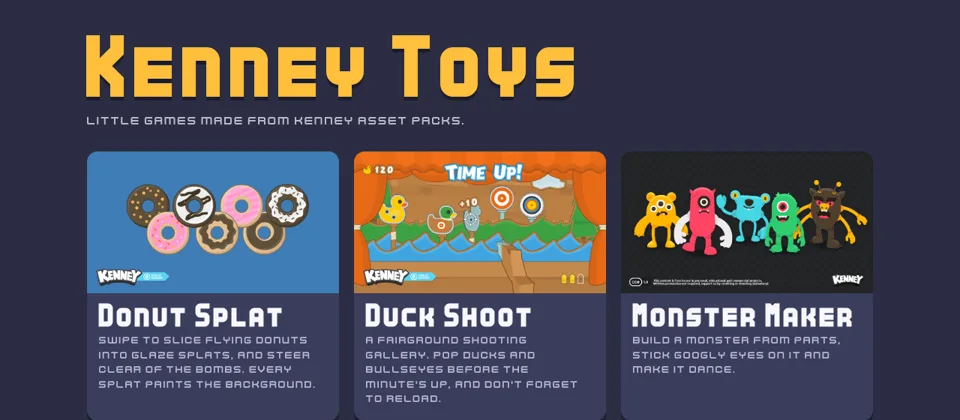

## Games

| | Game | Built from |
|---|---|---|
| 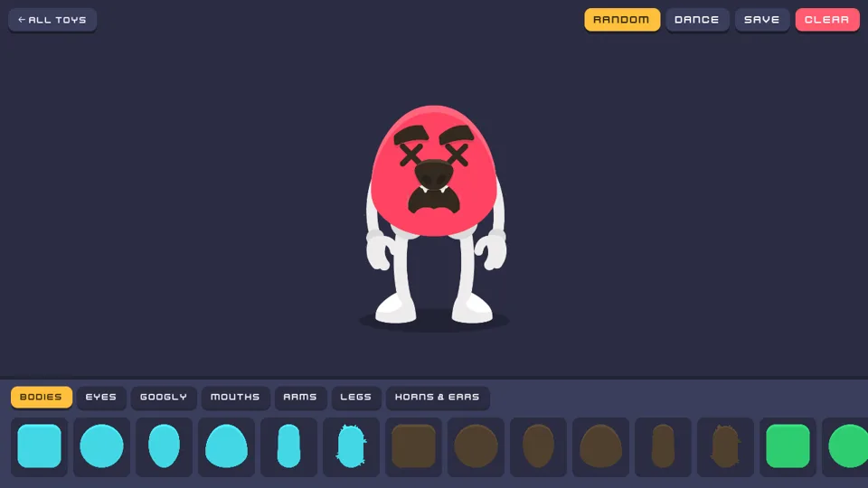 | **[Monster Maker](https://toys.projectz.co.nz/games/monster-maker/)**<br>Build a monster from parts, stick googly eyes on it that follow your cursor, make it dance and save it as a PNG. | Monster Builder Pack, Googly Eyes |
| 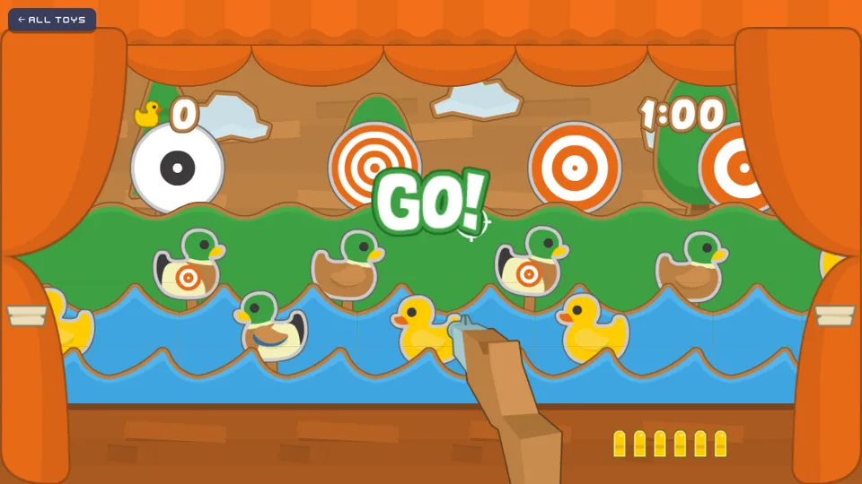 | **[Duck Shoot](https://toys.projectz.co.nz/games/duck-shoot/)**<br>Fairground shooting gallery. Pop ducks and bullseyes before the minute's up, and don't forget to reload. | Shooting Gallery |
| 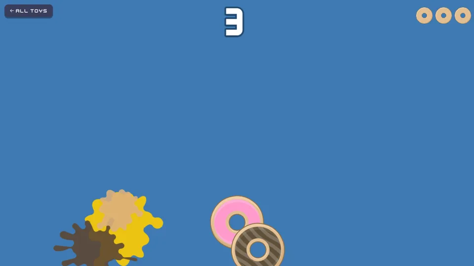 | **[Donut Splat](https://toys.projectz.co.nz/games/donut-splat/)**<br>Swipe to slice flying donuts and avoid the bombs. Every slice paints a glaze splat on the background. | Donuts, Splat Pack |
| 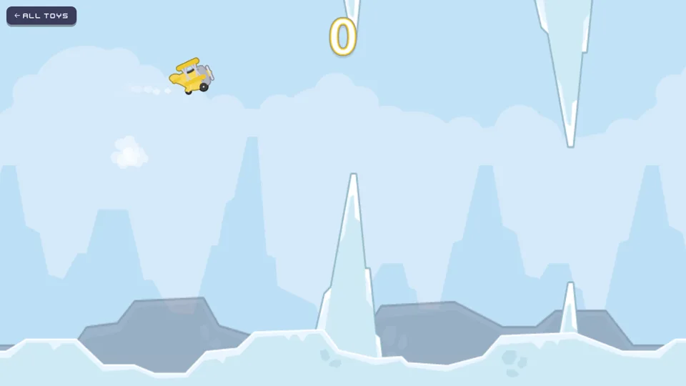 | **[Tappy Plane](https://toys.projectz.co.nz/games/tappy-plane/)**<br>Flappy Bird with a propeller plane. Tap through the rock gaps and earn bronze, silver and gold medals. | Tappy Plane |
| 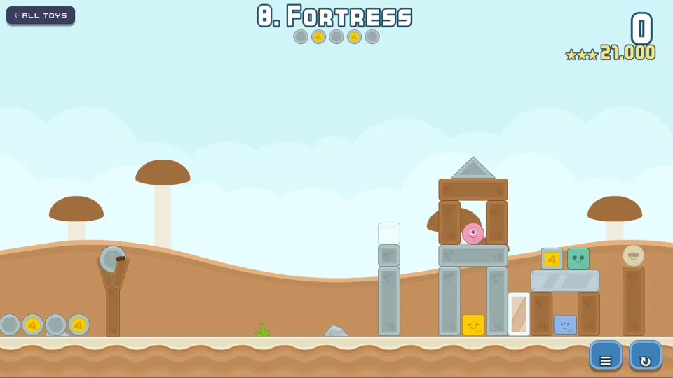 | **[Topple](https://toys.projectz.co.nz/games/topple/)**<br>Angry Birds-style physics. Sling boulders and bombs at glass, wood, stone and TNT forts across eight levels. | Physics Assets |
| 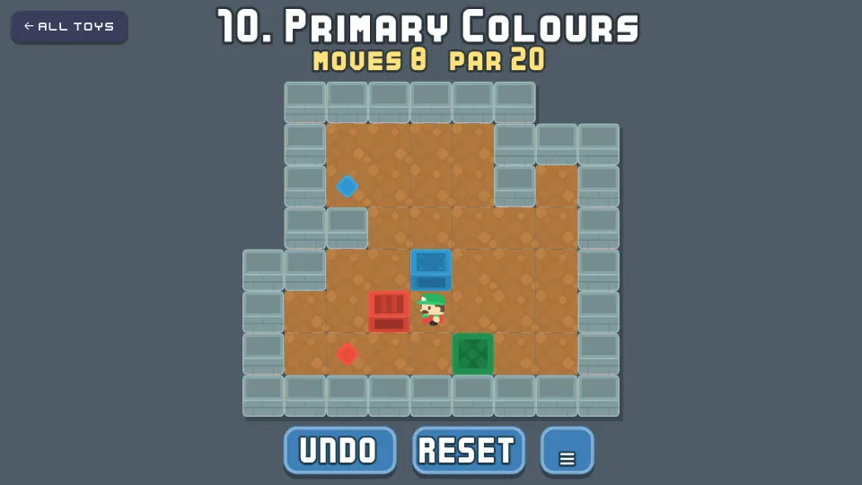 | **[Sokoban](https://toys.projectz.co.nz/games/sokoban/)**<br>Push every crate onto its spot across twelve warehouse puzzles, some with colour-matched crates. Unlimited undo, and coins for matching par. | Sokoban Pack |
| 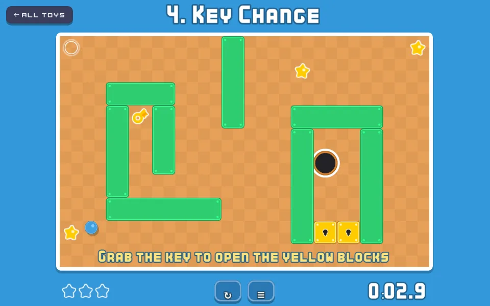 | **[Tilt Maze](https://toys.projectz.co.nz/games/tilt-maze/)**<br>Tilt the board to roll a ball home past holes, spinners and lasers, with a key to find and three stars per level. Tilt your phone, use the arrow keys or drag. | Rolling Ball Assets |
| 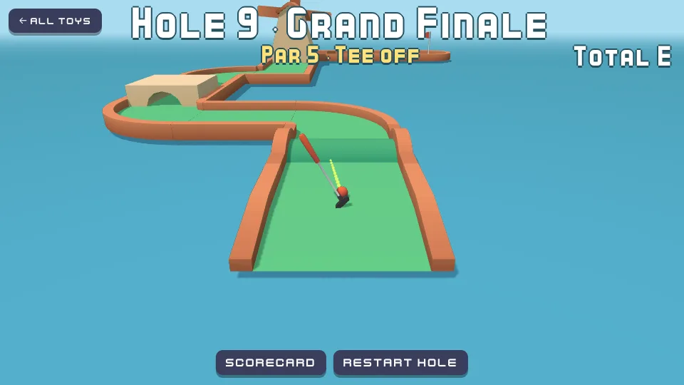 | **[Minigolf](https://toys.projectz.co.nz/games/minigolf/)**<br>Nine 3D holes floating on a pond, with castles, a windmill, ramps, bumps and a gap to clear. Drag back from the ball to putt, and mind the water. | Minigolf Kit |
| 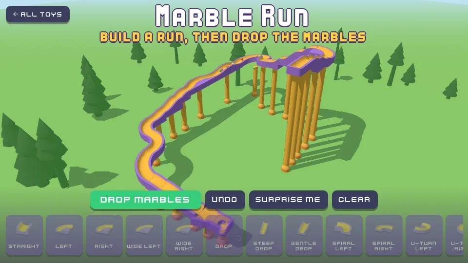 | **[Marble Run](https://toys.projectz.co.nz/games/marble-run/)**<br>Snap track together piece by piece (drops, spirals, U-turns, bumps and wiggles), then drop a stream of marbles and watch them race down. Or hit Surprise me for a random run. | Marble Kit |
| 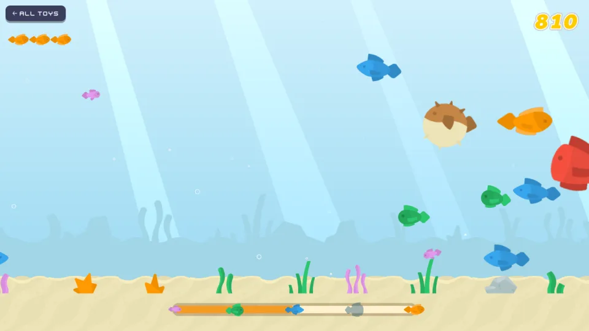 | **[Fish Frenzy](https://toys.projectz.co.nz/games/fish-frenzy/)**<br>Eat smaller fish to grow up the food chain, and stay clear of anything bigger, plus pufferfish and darting eels. Fill the growth bar to clear a wave. | Fish Pack |

More are on the way. [`CATALOG.md`](CATALOG.md) has a game idea for every pack in the bundle, and [`PLAN.md`](PLAN.md) tracks what's being built.

## Quick start

You need:
- **Node 22.5 or newer.** The build uses `fs.globSync` and `path.matchesGlob`.
- **The Kenney All-in-1 asset bundle (v3.7.0)**, unzipped next to this repo as `../Kenney Game Assets All-in-1 3.7.0`. Set `KENNEY_ROOT` to use another location. The assets aren't committed here.

```sh
npm install
npm run dev        # http://localhost:5173: the launcher and every game
npm run build      # typecheck, then build to dist/
npm run preview    # serve dist/
```

## How it works

It's one Vite + TypeScript project. Each game is its own page. The 2D games use [Phaser 4](https://phaser.io), and the 3D ones use [three.js](https://threejs.org) with [Rapier](https://rapier.rs) for physics. The launcher at the root finds the games automatically.

```
build/            Vite-side code: the Kenney asset plugin and game discovery
shared/           Runtime code every game can use
  kenney.ts         kenney('2D assets/…/file.png') → URL for a bundle file
  shell.ts          setupGamePage(): theme, Kenney fonts, back-to-launcher link
  phaser.ts         createGame() (fills parent) / createFixedGame() (letterboxed), sfx helpers
  storage.ts        Guarded localStorage and high scores
  theme.css         Colours, buttons, fonts
launcher/         The root index page
games/<id>/       One folder per game
  game.json         Title, description, thumbnail, asset globs
  index.html        Page entry
  src/
deploy/           deploy.sh, which ships a build to the server
docs/screenshots/ Images for this README
```

### Assets

The asset bundle has about 91,000 files, so nothing is copied into the repo:
- **In dev**, a small Vite plugin serves any bundle file under `/kenney/…`.
- **In the build**, only the files each game lists in its `game.json` `"assets"` globs are copied.
- **Missing assets are caught early.** The build fails if a glob matches nothing. Dev warns when a game loads a file it hasn't declared, so a missing declaration shows up before you ship.

### Adding a game

1. Create `games/<id>/` with `index.html`, `src/main.ts` and `game.json`.
2. In `main.ts`, call `await setupGamePage()`, then start the game, for example with `createGame()` or `createFixedGame()` from `@shared/phaser`.
3. Load files with `kenney('<path inside the bundle>')`, and list each one as a glob in `game.json`.

The launcher and the build pick up new games automatically. The checklist and conventions (play-testing, phone support, commits) are in [`PLAN.md`](PLAN.md).

## Deploying

```sh
deploy/deploy.sh
```

The script builds a clean export of the committed `HEAD` locally, because CI doesn't have the asset bundle. It copies the build to the server over Tailscale as a timestamped release in `/var/www/kenney-toys/releases/`, then swaps the `current` link to it in one step. Uncommitted changes never ship. The last five releases are kept, so you can roll back by pointing `current` at an older one.

Requests reach the site like this, all one-time setup that's already done:
1. **Cloudflare DNS:** `toys.projectz.co.nz` is a proxied CNAME to the `home-web-platform` Cloudflare Tunnel.
2. **Tunnel:** the ingress rule in `/etc/cloudflared/config.yml` sends it to Caddy on `127.0.0.1:80`.
3. **Caddy:** the site in `/etc/caddy/Caddyfile` serves `/var/www/kenney-toys/current` as static files. Hashed `/assets/*` files are cached as immutable.

## Credits

- **Art, sound and fonts:** [Kenney](https://kenney.nl), released under [CC0](https://creativecommons.org/publicdomain/zero/1.0/). Each game's `game.json` lists the packs it uses.
- **Built with:** [Phaser](https://phaser.io), [three.js](https://threejs.org), [Rapier](https://rapier.rs), [Vite](https://vite.dev) and [TypeScript](https://www.typescriptlang.org).

## License

The code is under the [MIT License](LICENSE). The Kenney assets are CC0 (public domain) and aren't in this repository.
